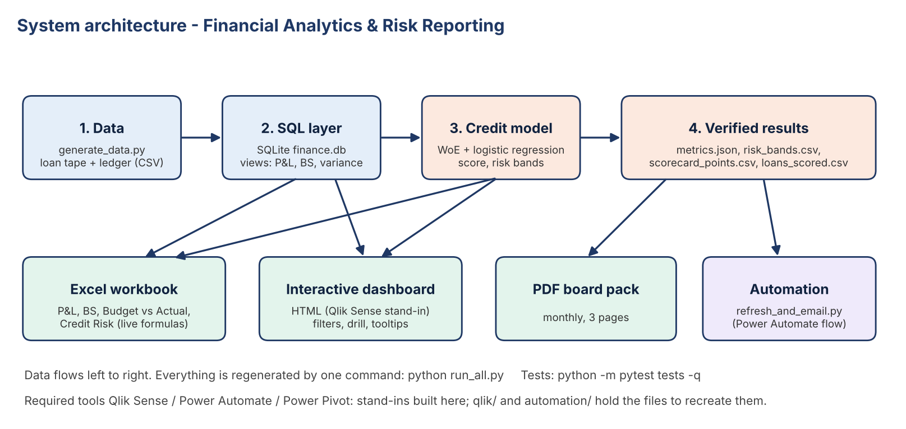

# Architecture

1. **Data** (`generate_data.py`) creates the loan tape and a ledger derived from it.
2. **SQL layer** (`build_db.py`, `sql/`) loads SQLite and defines views: `v_pnl`, `v_balance_sheet`, `v_budget_variance`, `v_interest_pvm` (volume/rate), `v_grade_performance`, `v_pnl_trend` (window functions). All finance reports read from these views, so the logic lives in one place.
3. **Credit model** (`credit_scorecard.py`): equal-frequency bins -> Weight of Evidence -> Information Value filter (>= 0.02) -> logistic regression -> points (600 at 30:1 odds, 20 points doubles odds) -> 5 risk bands from training-score quintiles. `grade` and `int_rate` are excluded (the lender's own pricing).
4. **Outputs**: Excel (formulas over data tables), HTML dashboard (data embedded, no server), PDF board pack (reportlab + matplotlib).
5. **Automation**: `refresh_and_email.py` rebuilds everything and emails the PDF (dry run by default).

**Design choices**: SQL views as the single source of finance logic; Excel uses formulas, not pasted values, so it recalculates; every output is reproducible from one command; tests assert Excel = SQL and the model is calibrated.
